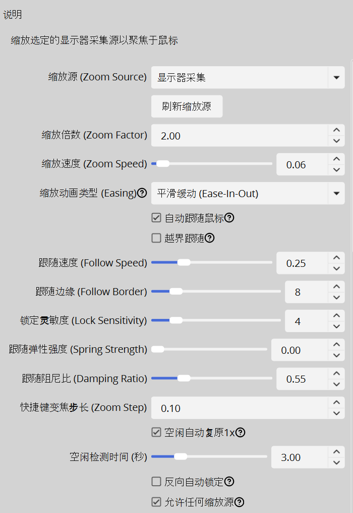
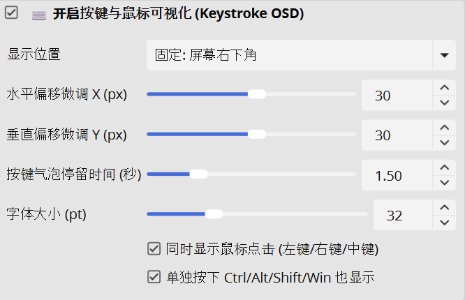
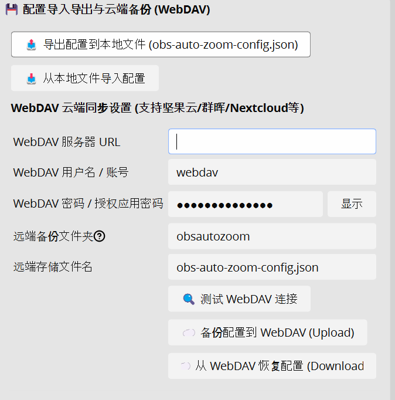
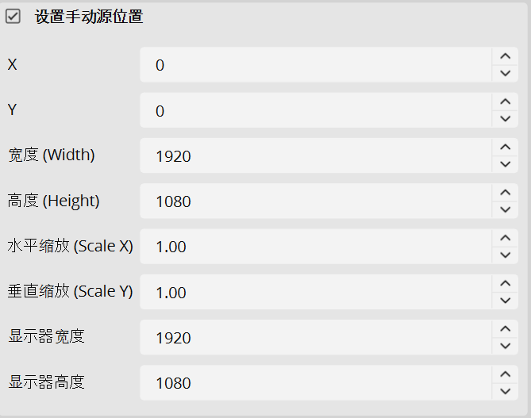
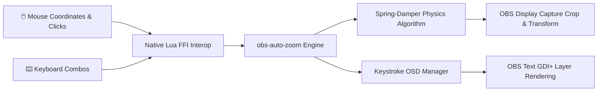

  

# obs-auto-zoom

  
  
  
  
  

  <b>适用于 OBS Studio 的智能鼠标跟随缩放与操作演示插件</b> 
  <a href="#简体中文">简体中文</a> | <a href="#english">English</a>

---

## 简体中文

`obs-auto-zoom` 是一款为 OBS Studio 开发的高效演播脚本。在软件录屏、教学培训、游戏解说或演示直播时，按下快捷键即可平滑拉近镜头聚焦至鼠标所在位置并自动平稳跟随，同时支持实时将键盘按键与鼠标点击动作投射在画面上。

### 🌟 核心特性矩阵

| 🎯 智能镜头跟随 | ⌨️ 按键与鼠标可视化 (OSD) | ☁️ 配置与云端同步 (WebDAV) |
| :--- | :--- | :--- |
| • **二阶弹性缓冲**：基于阻尼弹簧算法，镜头平稳移动不突兀 • **空闲自动复原**：光标静止设定秒数后自动拉远回 1x 全屏 • **动态变焦与锁定**：快捷键无级调节放大倍率，可锁死焦点 | • **按键悬浮气泡**：实时渲染按键组合（如 `Ctrl + C`）与鼠标点击 • **灵活位置预设**：支持跟随光标悬浮或固定在 7 种屏幕边角 • **样式自由定制**：支持毫秒级停留时长、字体字号与像素偏移微调 | • **全量热备份**：42 项设置及 5 组快捷键一键导出为独立 JSON • **多云盘无缝直连**：原生支持坚果云、Nextcloud、群晖、ALiST 等 • **自动目录归档**：远端自动建档至 `obsautozoom` 目录 |

---

### 🏛️ 技术架构与工作原理

脚本采用原生 **Lua FFI** 直连操作系统底层 API 捕获全局键鼠动作；镜头移动经二阶物理阻尼算法滤波后，实时作用于 OBS 画面转换矩阵：

---

### 🚀 快速上手

1. **下载脚本**：在 [Releases](https://github.com/LACS-Official/obs-auto-zoom/releases) 页面下载单文件 `obs-auto-zoom.lua`。
2. **导入脚本**：打开 OBS Studio，点击顶部菜单栏 **工具 -> 脚本**，在弹窗左下方点击 **`+`** 导入下载的文件。
3. **关联采集源**：在属性面板中，将 **缩放源 (Zoom Source)** 下拉框选择为您场景中的显示器采集源。
4. **绑定快捷键**：进入 OBS **设置 -> 快捷键**，搜索 `[obs-auto-zoom]` 并绑定常用键位（如 `Alt + Z` 切换缩放）。

---

### 📸 功能界面与参数设置

#### 1. 核心缩放与物理跟随设置
控制缩放倍数、镜头平滑过渡曲线、二阶阻尼弹簧硬度以及光标静止自动拉远复原。

#### 2. 按键与鼠标可视化 (Keystroke OSD)
勾选启用后，在当前场景自动生成按键悬浮气泡。支持跟随光标或吸附于屏幕边角，自由调节 X/Y 像素微调、字号及停留时间。

#### 3. 配置导入导出与 WebDAV 云端备份
支持一键将当前配置（含全部参数与快捷键）备份到本地 JSON 文件，或通过 WebDAV 协议上传至云端服务器进行多设备同步。

<b>🛠️ 点击展开：高级多屏坐标与手动位置覆盖 (Manual Override)</b>

 

针对多显示器异构分辨率、复杂拼接屏或非显示器采集源场景，可勾选“设置手动源位置”进行像素级绝对坐标覆盖：

---

### ⌨️ 快捷键列表

在 OBS 的 **设置 -> 快捷键** 中搜索 `[obs-auto-zoom]` 即可配置：

| 快捷键功能 | 推荐键位 | 详细说明 |
| :--- | :--- | :--- |
| **[obs-auto-zoom] 切换缩放至鼠标** | `Alt + Z` | 开启或关闭画面放大跟随 |
| **[obs-auto-zoom] 切换镜头焦点锁定** | `Alt + L` | 锁死当前放大的视口，鼠标移开时不跟随 |
| **[obs-auto-zoom] 增大缩放倍数** | `Alt + =` | 按变焦步长动态拉近放大倍率 |
| **[obs-auto-zoom] 减小缩放倍数** | `Alt + -` | 按变焦步长动态拉远放大倍率 |
| **[obs-auto-zoom] 在缩放时切换跟随鼠标** | `Alt + F` | 临时切换镜头是否跟随鼠标移动 |

---

### ❓ 常见问题排查 (FAQ)

<b>Q1: 按下快捷键后画面没有任何反应？</b>

<ol>
  <li>请确认当前预览区活动场景中包含您在脚本面板所选的“显示器采集源”。</li>
  <li>若当前显示器采集源已被群组锁定或设置了非默认缩放，可点击脚本面板中的“刷新缩放源”重新识别。</li>
  <li>请确认在 OBS 的“设置 -> 快捷键”中成功配置并保存了 <code>[obs-auto-zoom]</code> 对应快捷键。</li>
</ol>

<b>Q2: WebDAV 备份提示 405 错误该如何解决？</b>

在 v1.0.2 版本中，脚本已内置子目录自动创建功能（默认为 <code>obsautozoom</code>）。请确保：

<ol>
  <li>WebDAV URL 填写格式正确（例如 ALiST 为 <code>https://your-domain.com/dav/</code>）。</li>
  <li>账号具备 WebDAV 写入权限。脚本会自动通过 <code>MKCOL</code> 创建子目录并将配置上传至其中。</li>
</ol>

<b>Q3: 多显示器或不同缩放比例（125%、150% DPI）下光标定位有偏移？</b>

Windows 系统在多屏幕混合 DPI 缩放下可能会返回虚拟化坐标。在脚本设置中展开“设置手动源位置”，手动输入该显示器的物理分辨率（如 1920×1080）及水平/垂直缩放即可校准。

---

## English

A mouse-following zoom and presentation script for OBS Studio. Ideal for software tutorials, presentations, and live streaming where smooth camera focus on cursor interactions and on-screen keystroke feedback are needed.

### 🌟 Feature Matrix

| 🎯 Smart Camera Tracking | ⌨️ Keystroke & Mouse OSD | ☁️ Cloud & Config Sync (WebDAV) |
| :--- | :--- | :--- |
| • **Spring-Damper Physics**: Inertial smooth panning with no abrupt motions • **Auto-Reset on Idle**: Reverts zoom to 1x when mouse stays stationary • **Step Zoom & Focus Lock**: Real-time magnification adjustment & viewport lock | • **On-Screen Key Bubbles**: Visualizes combos (e.g. `Ctrl + C`) & mouse clicks • **Preset Layouts**: Follows cursor or docks to 7 screen corners • **Full Customization**: Custom fade duration, font sizes, and pixel offsets | • **Full Config Portability**: Bundles all 42 settings & hotkeys into standalone JSON • **Multi-Provider WebDAV**: Connects to Nextcloud, Synology, ALiST, Jianguoyun • **Auto Directory Management**: Creates and syncs to `obsautozoom` folder |

---

### 🏛️ Architecture & Dataflow

---

### 🚀 Quick Start

1. **Download**: Grab `obs-auto-zoom.lua` from [Releases](https://github.com/LACS-Official/obs-auto-zoom/releases).
2. **Add to OBS**: In OBS Studio, open **Tools -> Scripts**, click the **`+`** icon at the bottom-left, and select `obs-auto-zoom.lua`.
3. **Choose Source**: In the script properties panel, set **Zoom Source** to your active Display Capture source.
4. **Set Hotkeys**: Navigate to OBS **Settings -> Hotkeys**, filter by `[obs-auto-zoom]`, and bind your preferred keys (e.g. `Alt + Z`).

---

### 📸 Screenshots & Setting Panels

#### 1. Core Zoom & Physics Tracking
Adjust magnification ratio, easing curves, spring hardness, damping ratio, and idle auto-reset.

#### 2. Keystroke & Mouse OSD
Renders floating keystroke bubbles in real time. Can follow cursor or dock to screen corners with customizable durations and font sizes.

#### 3. Config Import/Export & WebDAV Cloud Backup
One-click JSON export/import and seamless WebDAV cloud synchronization with automatic directory creation.

<b>🛠️ Click to expand: Advanced Manual Source Position Override</b>

 

Designed for multi-monitor setups with mismatched DPI scaling or non-display sources:

---

### ⌨️ Hotkey Reference

Filter by `[obs-auto-zoom]` in OBS **Settings -> Hotkeys**:

| Hotkey Name | Suggested Key | Description |
| :--- | :--- | :--- |
| **[obs-auto-zoom] Toggle Zoom To Mouse** | `Alt + Z` | Enables or disables zoom tracking mode |
| **[obs-auto-zoom] Toggle Lock Focus** | `Alt + L` | Locks camera viewport at current location |
| **[obs-auto-zoom] Increase Zoom Factor** | `Alt + =` | Increments zoom magnification by step size |
| **[obs-auto-zoom] Decrease Zoom Factor** | `Alt + -` | Decrements zoom magnification by step size |
| **[obs-auto-zoom] Toggle Mouse Follow** | `Alt + F` | Toggles cursor tracking while zoomed |

---

### ❓ Troubleshooting & FAQ

<b>Q1: Nothing happens when pressing the hotkey?</b>

<ol>
  <li>Ensure the active scene contains the Display Capture source selected in the script panel.</li>
  <li>If the source was modified or grouped, click "Refresh Zoom Sources" in the script panel.</li>
  <li>Verify hotkey bindings under OBS Settings -> Hotkeys.</li>
</ol>

<b>Q2: WebDAV returns HTTP 405 error on backup?</b>

In v1.0.2+, the script automatically creates and uploads into the <code>obsautozoom</code> folder. Ensure your WebDAV URL is correct and your account has write permissions.

---

## 📄 开源许可证 / License

本项目基于 [MIT License](LICENSE) 开源许可。欢迎提交 Issue 与 Pull Request。 / This project is licensed under the [MIT License](LICENSE). Contributions and issues are welcome.
